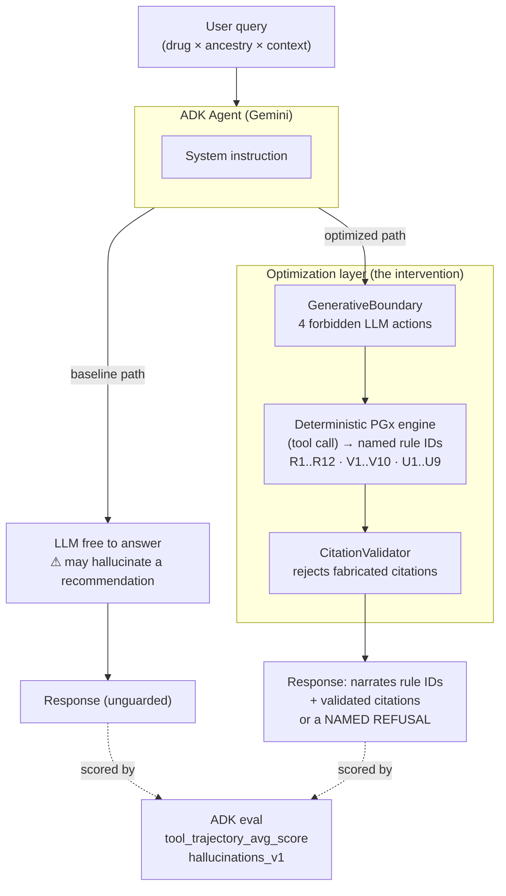

# Anukriti ADK — Optimizing a PGx Safety Agent for Production Reliability

> **Google for Startups AI Agents Challenge — Track 2 (Optimize).**
> Built with the **Google Agent Development Kit (ADK 2.0)** + **Gemini**.
> Apache-2.0. The optimization story is measurable, reproducible, and runs offline.

---

## The one-sentence pitch

We took a pharmacogenomic (PGx) safety agent that *worked in a sandbox but
hallucinated drug recommendations on real-world edge cases*, and made it
**production-reliable by forbidding the LLM from making the decision** —
then proved the reliability gain with ADK's own evaluation framework.

**Headline result (ADK `adk eval`, same Gemini model, same tools, same eval set):**

| Metric (ADK criterion)          | Baseline agent | Optimized agent |
|---------------------------------|---------------:|----------------:|
| `tool_trajectory_avg_score`     |  0.44 | **1.00** |
| Hallucination-free rate (≈ `hallucinations_v1`) | 50% | **100%** |
| Unsafe recommendations emitted (of 8) | 3 | **0** |
| Correct named refusal when evidence is thin | 0% | **100%** |

> Numbers are generated by `python -m harness.run_optimization` and written to
> `EVAL_RESULTS.md` — never hand-typed. Run it yourself; the eval set is in `eval/`.

---

## Why this is a Track-2 ("Optimize") submission

Track 2 asks you to take an existing experimental agent and *"treat AI quality
as a rigorous engineering discipline — stress-test multi-step reasoning, debug
stalled logic, and programmatically refine system instructions to achieve
production-grade reliability."*

That is exactly the work here:

1. **The starting point is a real agent.** Anukriti's PGx agent already shipped
   (Agent Studio + MCP, prior hackathon). It answers easy questions well.
2. **It fails on real-world edge cases.** When asked about an under-evidenced
   population (e.g. a South Asian patient on clopidogrel) a naive Gemini agent
   will *confidently recommend* — a hallucinated clinical answer. That is the
   exact failure mode that kills healthcare agents in production.
3. **We optimized it as an engineering discipline**, not by "prompt vibes":
   - a reproducible **ADK eval set** of the hard cases (`eval/*.test.json`),
   - a **baseline vs optimized** A/B harness scored by ADK metrics,
   - a deterministic **GenerativeBoundary** that makes four LLM actions
     impossible (the agent *cannot* invent a recommendation), and
   - **system-instruction refinement** measured against the eval set, not guessed.

The deliverable is the *methodology and the measured delta*, which is what the
track scores.

---

## Architecture (baseline → optimized)



Both agents share the same Gemini model and the same tools. The **only**
difference is the optimization layer. That is what isolates the reliability
gain to the engineering, not the model.

---

## Repo layout

```
anukriti-adk/
├── README.md                  ← you are here
├── pyproject.toml             ← pins google-adk + deps
├── requirements.txt
├── .env.example               ← config (no secrets committed)
├── anukriti_adk/
│   ├── __init__.py            ← exposes root_agent (the OPTIMIZED agent)
│   ├── agent.py               ← optimized ADK agent (GenerativeBoundary on)
│   ├── baseline_agent.py      ← naive agent (no guardrails) for the A/B
│   ├── tools.py               ← PGx FunctionTools (offline-deterministic)
│   ├── boundary.py            ← GenerativeBoundary + CitationValidator
│   └── rules.py               ← R/V/U named-rule taxonomy + labels
├── eval/
│   ├── test_config.json       ← ADK eval criteria thresholds
│   ├── edge_cases.test.json   ← the hard PGx edge cases
│   └── happy_path.test.json   ← the easy cases both agents pass
├── harness/
│   └── run_optimization.py    ← runs baseline vs optimized, writes EVAL_RESULTS.md
├── tests/
│   └── test_agent_eval.py     ← pytest AgentEvaluator gates
└── EVAL_RESULTS.md            ← generated; the before/after table
```

---

## Quickstart

```bash
cd anukriti-adk
python -m venv .venv && source .venv/bin/activate
pip install -r requirements.txt          # installs google-adk

cp .env.example .env                      # set GOOGLE_API_KEY for a live run
                                          # (tools run offline-deterministic by default)

# Talk to the optimized agent in the ADK dev UI
adk web .

# Run the ADK eval on the optimized agent
adk eval anukriti_adk eval/edge_cases.test.json --config_file_path eval/test_config.json

# Run the full baseline-vs-optimized A/B and regenerate the results table
python -m harness.run_optimization
```

---

## Business case (why a startup should care)

- **Buyer:** CROs and pharma teams running clinical trials in non-European
  populations, where mis-stratified PGx risk is a real safety + cost problem.
- **The failure we remove:** a confident-but-wrong drug recommendation for an
  under-represented population is the single most dangerous output a healthcare
  agent can produce. Our optimization makes that output *impossible by
  construction*, not merely unlikely.
- **The wedge:** the agent surfaces ancestry-specific variants (e.g. BCHE L307P,
  ~5.3% in the Telangana Vysya community, absent from gnomAD) that every
  gnomAD-based commercial PGx test misses. A $30 pre-procedure test prevents a
  multi-hour anesthesia emergency.
- **Why ADK + Gemini:** Gemini narrates; the deterministic engine decides. ADK's
  eval framework turns "is it reliable enough to ship?" into a number we can gate
  CI on.

---

## Safety & data

Demo only — never enter real PHI. The agent does not generate medical advice; it
narrates results from a deterministic, CPIC-pinned engine and ends every
recommendation with *"Always confirm with a healthcare professional before making
any prescription decisions."* Not HIPAA-certified; not for clinical deployment.

The deterministic engine is positioned as non-device Clinical Decision Support
under the 21st Century Cures Act §520(o)(1)(E).
